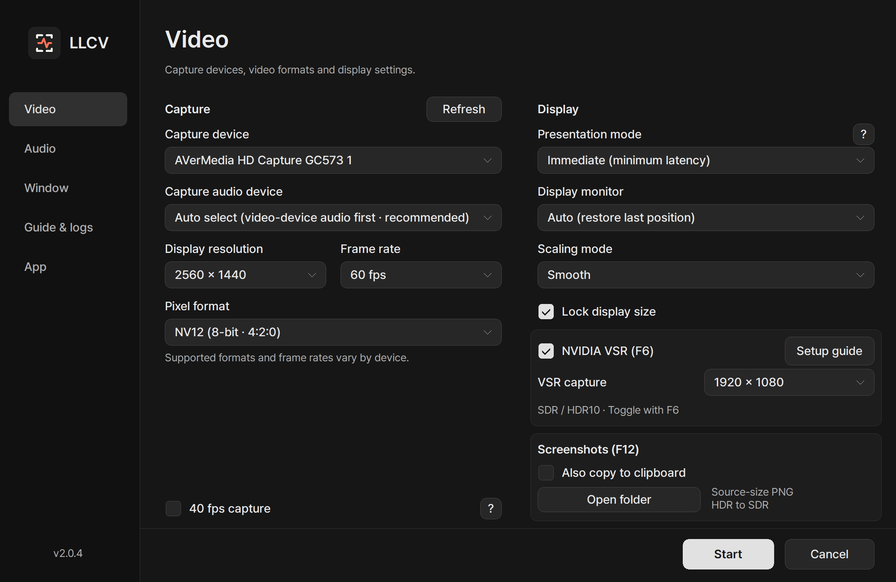
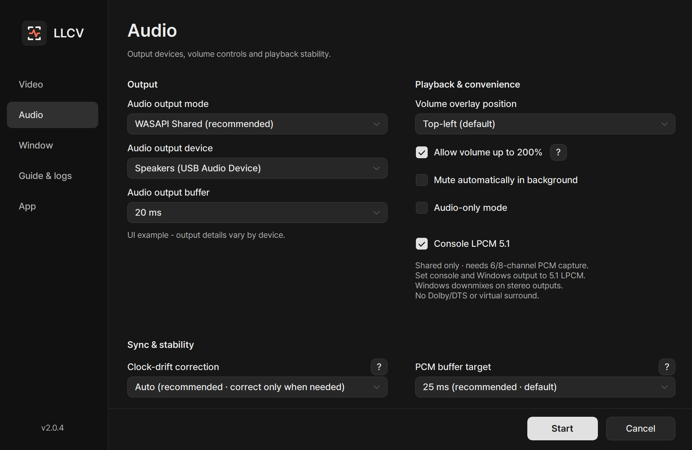

# LLCV - Low Latency Capture Viewer

A low-latency Windows viewer for video and audio from HDMI capture devices.
Use it to play console games without OBS, or listen in audio-only mode.

**[Download](https://github.com/seria-aa/LowLatencyCaptureViewer/releases/latest)** · [User guide](docs/USAGE.md) · [Release notes](docs/release-notes-v2.0.4.md) · [한국어](README.ko.md)

 

| Video settings | Audio settings |
| --- | --- |
|  |  |

Settings examples rendered from the 2.0.4 UI code. Click an image to view it at full resolution.

 

## What's new in 2.0.4

Added **40 fps capture** in Video settings. Enable it to request 40 fps from the
driver; disable it to restore the normal frame-rate selection. It is off by
default, and support is checked at startup. Enable it only when needed; normal
viewing can keep the existing frame-rate selection. Existing settings and installation paths are retained.
[40 fps capture guide](docs/VIDEO.md#40-fps-capture) · [Full release notes](docs/release-notes-v2.0.4.md)

 

## Install and run

Requires Windows 10/11 x64 and a capture-device driver.
No codec pack, FFmpeg, or separate Visual C++ Redistributable is needed.

Download the installer ending in **Setup.exe** from the [latest release](https://github.com/seria-aa/LowLatencyCaptureViewer/releases/latest).
For the portable version, extract **x64.zip** and run `LowLatencyCaptureViewer.exe`.

1. Close OBS and other apps using the capture device.
2. Check **Capture device** in LLCV and select **Start**.
3. If audio is missing, check **Capture audio device**.

<kbd>F1</kbd> Help · <kbd>F2</kbd> Settings · <kbd>F6</kbd> VSR · <kbd>F11</kbd> Fullscreen · <kbd>F12</kbd> Screenshot · <kbd>Tab</kbd> Diagnostics

 

## Features

- Latest-frame-first presentation with Immediate or VSync output
- NV12/YUY2, MJPEG, and P010 HDR10 input
- Optional 40 fps capture where supported by the device and driver
- NVIDIA VSR (experimental), with separate capture and display resolutions
- WASAPI Shared/Exclusive, ASIO, console LPCM 5.1, and audio-only mode
- Source-resolution PNG screenshots with optional clipboard copy
- Sleep prevention during playback, with display sleep allowed in audio-only mode
- Dark/light themes, fullscreen, window size locking, volume controls, Korean/English UI

HDR10 needs compatible hardware and an HDR display; ASIO needs its driver.
LPCM 5.1 requires multichannel capture and Shared output.

VSR depends on GPU/driver support and may add latency. HDR screenshots are saved as SDR.
See the [feature requirements](docs/USAGE.md#compatibility-and-feature-requirements).

 

## Documentation

The [documentation index](docs/INDEX.md) also lists release notes and development/validation records.

- [User guide](docs/USAGE.md) — settings, sleep prevention, shortcuts, VSR, and screenshots
- [Video and HDR](docs/VIDEO.md) / [Audio and 5.1](docs/AUDIO.md)
- [Troubleshooting](docs/TROUBLESHOOTING.md) / [Diagnostics and logs](docs/DIAGNOSTICS.md) / [Build from source](docs/BUILDING.md)

For Linux, see the independently maintained [LLCV for Linux](https://github.com/Meo-Hong/LLCV-for-Linux) fork.
Installation instructions, supported environments, and support are handled in that repository.

---

Copyright (C) 2026 seria-aa. [GNU GPL v3.0 or later](LICENSE).
