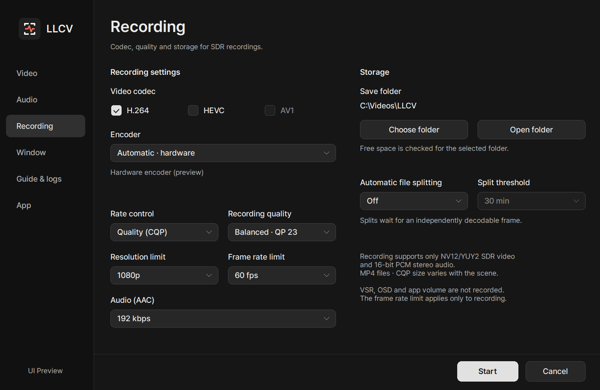

# Recording

[README](../README.md) · [Documentation](INDEX.md) · [한국어](RECORDING.ko.md)

Records NV12/YUY2 SDR video with 16-bit PCM stereo input to MP4.
MJPEG, HDR, multichannel and audio-only recording are not supported; playback supports more formats.

 

## Start and stop

1. Set the save folder, codec and quality under **Recording**.
2. Start SDR/stereo playback, then press **F9** to record. Press it again to finalize.
3. Use **Open folder** to check the result. Wait until **Finalizing** completes before opening the file.

Opening the Recording tab for the first time checks encoder support. Supported codecs and rate-control modes become selectable when the check completes.

F9 is the default and can be changed under **Guide & logs**. If an existing binding already uses F9, an unused function key is assigned; check the displayed binding.
During recording, the Recording tab offers pause/resume. Paused time is removed from the file timeline while playback continues.
The corner recording indicator and OSD are not included in the recording.

 

## Quality and file size

Defaults: **H.264 · automatic hardware · quality (CQP) · balanced (QP 23)**, **1080p/60fps limits**, AAC 192 kbps and splitting off. Lower-resolution/rate input stays unchanged, and existing saved recording preferences are preserved.

| Setting | Behavior |
| --- | --- |
| H.264 / HEVC / AV1 | Enabled only when the installed encoder and container support it. Availability does not guarantee real-time encoding at every resolution/rate. |
| Encoder | Automatic hardware or a supported CPU encoder. No separate software AV1 encoder is bundled. |
| Quality (CQP) | Smaller files (QP 26), balanced (QP 23), higher quality (QP 20). Size varies with content; the same QP does not imply identical quality across codecs/vendors. |
| Target bitrate | Video 2–100 Mbps, audio 128/192 kbps. Actual size depends on encoder behavior and container overhead. |
| Resolution / frame limit | Match capture or 1440p/1080p/720p and 60/30 fps. Never raises the source size/rate and does not alter playback settings. |
| Automatic splitting | Off, duration (15/30/60/120 minutes), or size (1/2/4/8/16 GiB). A segment waits for an independently decodable boundary and may exceed the threshold. |

VSR, display scaling/placement, OSD, screenshot processing and app volume changes are not recorded.
Unsupported combinations report an error instead of silently changing codec or switching to CPU encoding.
If encoding affects playback or cannot keep up, lower the recording resolution/frame-rate limit first.

 

## Storage and file protection

The default folder is **Videos → LLCV**. Choose another folder in settings.
Low space, write failures and overload stop recording with a notice while playback continues.
Closing during recording asks for confirmation, then finishes saving. If saving stalls, follow the prompt; forcing an exit may lose the final section.

H.264, HEVC and AV1 all use fragmented MP4. Already-written fragments may survive an unexpected exit, but the final fragment, OS write cache and disk failures are not fully protected. Keep the file and check it with a compatible player. This is not automatic recovery or a lossless guarantee.

Playback settings keep their existing location. Recording preferences are separate; the internal filename `recording-prototype.ini` is retained for compatibility with prototype users. Copies of the installation folder share settings within the same Windows account.

---

[User guide](USAGE.md) · [Troubleshooting](TROUBLESHOOTING.md) · [한국어](RECORDING.ko.md)
